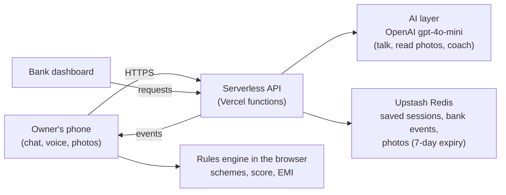

# Saathi — voice-first loan file builder for small businesses

**Team Olelama · Tech4Bharat (GAVS 2026) · Problem 3.2: viable small businesses cannot reach formal credit or the schemes meant for them**

| | |
|---|---|
| **Live demo app** | https://saathi-sand-gamma.vercel.app/ |
| **Scripted demo (no AI calls)** | https://saathi-sand-gamma.vercel.app/demo |
| **Code** | https://github.com/geethatigulla/saathi |

A tailor, welder, dairy farmer or SHG member talks to Saathi in Kannada, Hindi or English, by voice or text. Saathi finds the government schemes they qualify for, checks that the EMI is safe even in their slowest month, reads their document photos, rehearses the bank interview with them, and builds a complete, cited loan file. Nothing reaches the bank until the owner says yes.

---

## Contents

- [The problem](#the-problem)
- [What Saathi does](#what-saathi-does)
- [How it meets the brief](#how-it-meets-the-brief)
- [Architecture](#architecture)
- [Tech stack](#tech-stack)
- [Run it locally](#run-it-locally)
- [Deploy your own copy](#deploy-your-own-copy)
- [Environment variables](#environment-variables)
- [Project structure](#project-structure)
- [Privacy and compliance](#privacy-and-compliance)
- [What is real and what is simulated](#what-is-real-and-what-is-simulated)
- [Data sources and resources](#data-sources-and-resources)

## The problem

India has about **6.33 crore MSMEs**, almost all of them micro enterprises (NSS 73rd round, Ministry of MSME). SIDBI and Crisil estimate the sector's **addressable credit gap at about ₹30 lakh crore, 24% of its credit demand**; for women-owned MSMEs the gap is 35%, against 20% for men (May 2025).

The money and the schemes exist. What stops a viable business is the file: 15–20 documents, scheme rules nobody explains, name mismatches between documents, and agents who charge for help. Many end up with a moneylender at 24–36% a year (figures from the Tech4Bharat brief).

## What Saathi does

**On the owner's phone** (a WhatsApp-style chat that works in any phone browser):

1. **Talk** in Kannada, Hindi or English. Every message is read aloud; answers are buttons, never forms.
2. **Consent** to share 12 months of bank data for this one loan (Account Aggregator flow, sandbox).
3. **Schemes**: MUDRA (Shishu, Kishore, Tarun), PMEGP, Stand-Up India and CGTMSE are checked by fixed rules, each result linked to its official rule.
4. **Safe EMI**: if the slowest month cannot carry the EMI, Saathi recommends borrowing less and shows why.
5. **Documents**: four photos (Aadhaar, PAN, passbook, quotation). Saathi reads them, keeps only the last 4 digits of any ID, and catches name mismatches.
6. **Practice interview**: Saathi plays the bank manager and coaches the answers.
7. **Approve**: the full application is read back; the owner says "yes" and confirms a code.
8. **Follow-up**: the bank's requests (a workplace photo, a branch visit, sanction) arrive in the owner's chat, even days later. Progress is saved without a login.

**On the bank officer's dashboard**: a cluster view of files; the loan file (readiness score with reasons, affordability by month, cash flow, eligibility with sources, documents, consent and audit trail, seasonal EMI suggestion); the model's calibration and fairness audit; and a calculator for what an incomplete file costs the branch.

## How it meets the brief

| The brief asks | How Saathi does it |
|---|---|
| Every eligibility claim cites its source | A deterministic rules engine decides eligibility; every check links to the scheme's official page. The AI never decides eligibility. |
| Risk assessment that is calibrated, fair and explainable | A six-factor scorecard with plain-language reasons; a calibration chart and a gender and region fairness audit run live on 4,000 synthetic applicants; gender, caste, religion, region, name and marital status are never inputs. |
| Data used only with consent | Account Aggregator-style consent: one purpose, 12 months of data, 90 days, logged with the time. "Delete my data" removes the conversation and photos at once. |
| The entrepreneur approves every application | The application is read back in the owner's language and needs a spoken "yes" plus a confirmation code. |
| Field questions; follow the money | Intake captures the brief's field questions (schemes heard of, last loan attempt, agent fees, records kept). The bank's money tab works out what an incomplete file costs, from inputs a branch manager can change. |
| Low literacy, weak connectivity, low-cost phones | Voice in and out, buttons instead of forms, opens from a link with nothing to install, the rules engine runs on the phone, short text and voice only. |

## Architecture



The AI is used only for what language models do well: conversation, reading messy inputs and coaching. Every decision and every number comes from `public/engine.js`, which is deterministic and auditable.

## Tech stack

| Layer | Used in this build |
|---|---|
| Frontend | Plain HTML, CSS and JavaScript, no build step |
| Voice | Browser Web Speech API (speech recognition and synthesis); OpenAI speech-to-text and text-to-speech as a fallback |
| AI | OpenAI `gpt-4o-mini` with structured JSON outputs (Google Gemini supported as an alternative) |
| Rules and scoring | `public/engine.js`: scheme eligibility with sources, scorecard, affordability, cash flow, calibration and fairness audit |
| Backend | Node.js 20+ serverless functions on Vercel (`api/`) |
| Storage | Upstash Redis over its REST API (a local JSON file when run on your computer) |

## Run it locally

You need [Node.js 20 or newer](https://nodejs.org/).

**Without an AI key** (canned replies, to check the flow):

```bash
npm run mock
```

**With an OpenAI key:**

1. Copy `.env.example` to `.env` and put your key after `OPENAI_API_KEY=`.
2. Run:

```bash
npm run dev
```

Open http://localhost:3000. The scripted demo is at http://localhost:3000/demo. Saved conversations and photos go in `.data/` locally (git-ignored).

## Deploy your own copy

1. Import this repository in Vercel (framework preset: **Other**, no build command).
2. Add `OPENAI_API_KEY` under *Settings → Environment Variables*.
3. Add storage: *Storage → Create Database → Upstash for Redis* (free plan) and connect it to the project. Vercel adds `KV_REST_API_URL` and `KV_REST_API_TOKEN`.
4. Optional: set `ALLOWED_ORIGIN` to your site's address so only your site can call the API.
5. Redeploy.

Without Redis the app still works, but progress is lost when the server restarts, and the welcome screen says so.

## Environment variables

| Name | Needed | What it does |
|---|---|---|
| `OPENAI_API_KEY` | Yes (or `GEMINI_API_KEY`) | Key for the AI layer |
| `GEMINI_API_KEY` | Optional | Use Google Gemini instead of OpenAI |
| `AI_PROVIDER` | Optional | `openai` or `gemini` |
| `KV_REST_API_URL`, `KV_REST_API_TOKEN` | For saving | Upstash Redis (added by Vercel), or `UPSTASH_REDIS_REST_URL` / `UPSTASH_REDIS_REST_TOKEN` |
| `ALLOWED_ORIGIN` | Recommended | Comma-separated list of sites allowed to call the API |
| `RATE_PER_IP_HOUR`, `DAILY_CALL_CAP` | Optional | Soft limits (defaults: 150 an hour per device, 3,000 a day) |
| `SERVER_TTS` | Optional | `0` turns off server text-to-speech and uses the phone's own voice |
| `MOCK_AI` | Optional | `1` returns canned replies with no AI calls |

## Project structure

| Path | What it is |
|---|---|
| `public/index.html`, `public/styles.css`, `public/wa.css` | The page; `wa.css` is the WhatsApp-style chat screen |
| `public/app.js` | Owner chat (voice, text, photos), saved sessions and bank dashboard |
| `public/engine.js` | Rules engine: eligibility with sources, scorecard, affordability, sandbox statements, CSV reader, synthetic calibration and fairness audit |
| `public/demo.html` | Scripted walkthrough of a full case; works with no AI |
| `public/sample-statement.csv` | Sample bank statement for the CSV upload |
| `api/agent.js` | Conversation, explanations, interview coach, project report |
| `api/read-doc.js`, `api/transcribe.js`, `api/speak.js` | Document photos, voice in, voice out |
| `api/session.js`, `lib/store.js` | Saved conversations, bank-to-owner events, stored photos |
| `api/config.js` | Tells the page which AI and storage the server has |
| `lib/ai.js` | AI calls (OpenAI or Gemini), retries, limits, mock mode |
| `dev-server.js` | Local runner that behaves like Vercel |
| `site/index.html`, `saathi-demo.html` | Earlier single-file version of the scripted demo |

## Privacy and compliance

- Bank data only through a consent with one purpose and a 90-day limit (RBI Account Aggregator framework; sandbox in this build).
- "Delete my data" removes the saved conversation and document photos immediately (DPDP Act 2023).
- Document photos are kept for 7 days so the bank can check them, then deleted automatically. Only the last 4 digits of any ID are stored.
- The owner pays nothing. Under RBI's digital lending rules the lender, not the borrower, pays a lending service provider.
- No gender, caste, religion, region or name in the score; the bank officer makes the decision.
- Every chat starts with: "Saathi will never ask for money, your UPI PIN or a bank OTP."

## What is real and what is simulated

**Real:** the conversation, voice in and out, document reading and name cross-checks, scheme rules with sources, readiness score, affordability, practice interview, project report, saved sessions, bank-to-owner messages and stored photos.

**Simulated:** the Account Aggregator connection (sandbox data generated from what the owner says), the confirmation code (no SMS is sent), the calibration and fairness data (4,000 synthetic applicants), and the bank itself, a demo bank on the same page.

## Data sources and resources

**Figures used in the pitch**

- MSME count (6.33 crore): National Sample Survey 73rd round, reported in the [Ministry of MSME Annual Report](https://msme.gov.in/).
- Udyam and Udyam Assist registrations (7.30 crore by 17 Dec 2025): Ministry of MSME, Year End Review 2025, published by [PIB](https://pib.gov.in/).
- Credit gap (₹30 lakh crore, 24% of demand; women-owned 35% vs 20%): [SIDBI and Crisil, *Understanding Indian MSME Sector: Progress and Challenges*, May 2025](https://www.sidbi.in/blog/the-msme-credit-gap-in-india-what-does-the-data-say).
- Average MUDRA Kishore loan (₹1,20,111 in FY25): [Business Standard, April 2025](https://www.business-standard.com/amp/finance/news/average-loan-size-falls-in-kishor-rises-in-shishu-and-tarun-categories-125040700997_1.html).
- DSA commissions on business loans (about 0.5–3% of the disbursed amount): [Lendingkart](https://www.lendingkart.com/), [MyMudra](https://www.mymudra.com/blog/dsa-commission-in-india).
- AI cost per conversation: worked out from [OpenAI's list prices](https://openai.com/api/pricing/) for `gpt-4o-mini`.

**Scheme rules** (linked from every eligibility check): [PMMY / MUDRA](https://www.mudra.org.in/), [PMEGP (KVIC)](https://www.kviconline.gov.in/pmegpeportal/), [Stand-Up India](https://www.standupmitra.in/), [CGTMSE](https://www.cgtmse.in/).

**Services and libraries**: [OpenAI API](https://platform.openai.com/), [Google Gemini API](https://ai.google.dev/) (optional), [Vercel](https://vercel.com/), [Upstash Redis](https://upstash.com/), the browser [Web Speech API](https://developer.mozilla.org/docs/Web/API/Web_Speech_API), and Google Fonts (Bricolage Grotesque, Inter, Noto Sans Kannada, IBM Plex Mono).

All people, businesses and documents in the demo are fictional samples. Please use the sample documents, not real IDs.
